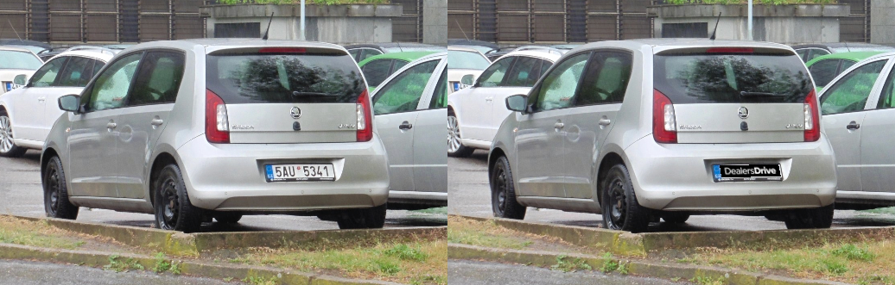
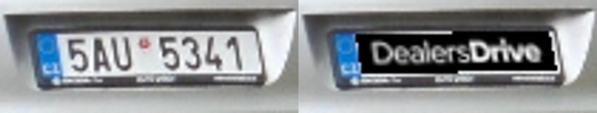

# DealersDrive plate evidence

Run from the repository root:

```sh
pnpm --filter @studiocar/image-processing-worker evidence:plates
```

The command uses the production detector child, surface refinement and
perspective renderer with the pinned model and supplied logo. It processes
the public `ankandrew/fast-alpr` example in `tests/fixtures/plate-branding/`;
upstream attribution and license accompany the fixture. No application
credentials, database, S3 or Leonardo request is used.

Original on the left, branded output on the right:



Enlarged plate detail (the source plate is only about 80 pixels wide):



`geometry.json` records the fitted quadrilateral and an independently counted
zero changed raw pixels outside it. `branded-original.png` is the full-size
lossless rendered result. The registration surface is replaced while its
existing frame and blue country strip remain.

Unit tests separately cover angled white/yellow/green plate surfaces, missing
and obscured surfaces, perspective mapping, crop scale/offsets, unchanged
surrounding pixels, duplicate/ambiguous detections, alpha/shadow rejection,
process crashes/hangs/invalid IPC, and exact fallback output/preview bytes.
The real-PostgreSQL lifecycle runs with branding disabled, applied and failed.
The Lambda packaging gate runs actual positive/negative model inference on
ARM64 Node 24 with 2 GB memory, one CPU, networking disabled and a read-only
filesystem (only `/tmp` is writable).

This evidence is not a measurement of detection accuracy across Indian dealer
photos, not proof of perfect redaction, and not a live Leonardo end-to-end
test. Low-confidence or unsupported surfaces retain the existing processing
result. Before production activation, review a few representative new jobs
and inspect `plate_branding_result` outcomes.
